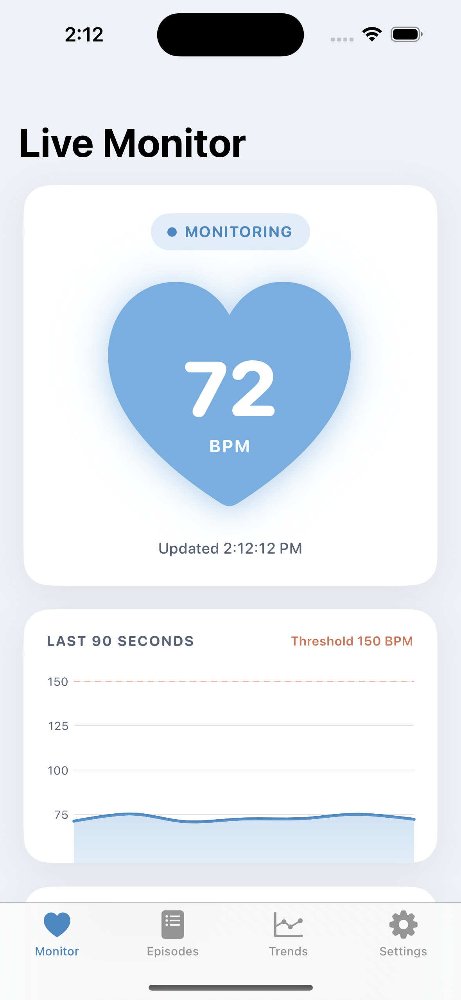
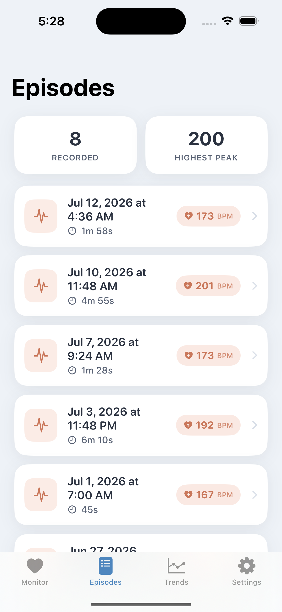
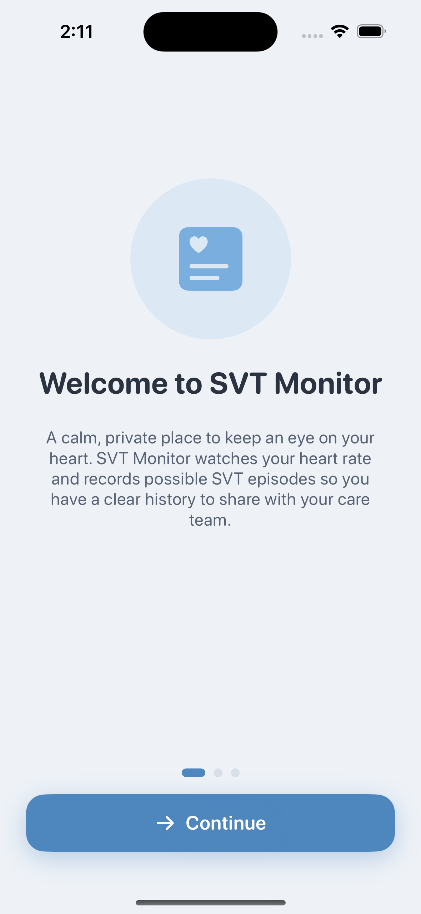

# SVT Monitor

An iOS app for living with **SVT (supraventricular tachycardia)**. It watches
heart-rate patterns and flags possible episodes with threshold-based alerting,
guides you through paced breathing while an episode is happening, and keeps a
clear, patient-friendly log of each one — timestamp, duration, peak BPM, the
symptoms you felt and anything that might have set it off — so you have
something concrete to show your care team.

Built with **Swift, SwiftUI, HealthKit, SwiftData and Swift Charts** for
iOS 17. Designed to read live **Apple Watch** heart-rate data on device, with a
built-in demo mode so the whole experience works without a watch (and in the
simulator).

> **Important:** SVT Monitor is a personal tracking tool, **not a medical
> device**. It does not diagnose, treat, or prevent any condition. Always
> consult your care team about symptoms.

---

## Screenshots

| Live Monitor | Episode Log | Onboarding |
|:---:|:---:|:---:|
|  |  |  |

---

## What it does

- **Live monitoring** — a calm dashboard with a heart that beats at your actual
  current rate, a status pill (MONITORING / POSSIBLE EPISODE), and a rolling
  90-second sparkline with the alert threshold drawn in.
- **Automatic episode detection** — a threshold state machine records an episode
  when your heart rate is sustained at/above the threshold *or* rises suddenly
  (both hallmarks of SVT), and closes it once the rate settles back down.
- **Threshold-based alerting** — when an episode is recorded you get a local
  notification: *"Possible SVT episode recorded — 2m 14s, peak 182 BPM."*
- **Episode tracking** — every episode is stored with its start timestamp,
  duration, peak BPM, average BPM, and a heart-rate trace you can chart.
- **Trends** — episodes-per-week bars and peak-BPM-over-time scatter across a
  selectable 30 / 90 / all-time range.
- **Calm mode** — opens by itself when an episode is detected. A guided
  breathing circle (box breathing, longer exhale, or 4-7-8) you can follow with
  your eyes shut, your live rate alongside it, reminders of any vagal maneuvers
  *your own care team has taught you*, and a plain list of when to stop and call
  for help.
- **Symptom and trigger tagging** — tag what you felt (palpitations,
  lightheaded, chest pressure, …) and what came before it (caffeine, stress,
  poor sleep, exercise, …), plus a 1–5 rating for how rough it was.
- **Manual logging** — episodes rarely wait until you're wearing a watch, so you
  can write one down afterwards. Manual entries are first-class episodes, simply
  flagged as hand-logged.
- **Patterns** — the Trends tab counts your most-reported symptoms and triggers
  across the selected range. It counts; it never claims causation.
- **Appointment export** — share a plain-text summary of any range (counts,
  durations, peaks, tags, and the full episode log) straight from the app.
- **Tunable + honest** — adjustable threshold and sudden-onset sensitivity, a
  data-source switch (Apple Watch vs. Demo), permission controls, and a plainly
  worded medical disclaimer.

---

## How to run

1. Open **`SVTMonitor.xcodeproj`** in Xcode (15.4+).
2. Pick an iOS 17 simulator (or your iPhone) as the run destination.
3. Press **Run**.

In the **simulator the app defaults to Demo mode** (there is no Apple Watch
data), so it comes pre-seeded with a few weeks of realistic history and lets you
press **Trigger episode** on the dashboard to watch detection, alerting, and
recording happen end-to-end. On a **real device it defaults to HealthKit** and
streams live Apple Watch heart rate.

### Command-line build (compile check)

```bash
xcodebuild -project "SVTMonitor.xcodeproj" -scheme SVTMonitor \
  -sdk iphonesimulator17.5 -destination 'generic/platform=iOS Simulator' \
  CODE_SIGNING_ALLOWED=NO build
```

> If no iOS **simulator runtime** is installed yet, the scheme-based command
> above can't resolve a destination and the asset-catalog step can't thin icons.
> To verify the code compiles against the SDK without a runtime, build the
> target directly:
>
> ```bash
> xcodebuild -project "SVTMonitor.xcodeproj" -target SVTMonitor \
>   -sdk iphonesimulator17.5 CODE_SIGNING_ALLOWED=NO \
>   ARCHS=arm64 ONLY_ACTIVE_ARCH=NO build
> ```

### Tests

```bash
xcodebuild -project "SVTMonitor.xcodeproj" -scheme SVTMonitor \
  -sdk iphonesimulator17.5 -destination 'platform=iOS Simulator,name=iPhone 15' \
  test
```

The test target covers the parts of the app where being wrong actually matters:

| Suite | Covers |
| --- | --- |
| `EpisodeDetectorTests` | Onset rule, hysteresis exit, peak/average correctness, duplicate and out-of-order samples |
| `BreathingPatternTests` | Phase ordering, cycle wrap-around, countdown rounding, zero-length and empty patterns, negative clock input |
| `EpisodeInsightsTests` | Averages, severity exclusion, tag ranking and tie-breaking, duplicate/unknown raw tags, appointment-summary contents |
| `SVTEpisodeTaggingTests` | Tag round-trip through `[String]` storage, unknown-value handling, red-flag detection, severity labels |

The test target compiles against the simulator SDK today; running it needs a
booted simulator runtime.

---

## How detection works

The core is `EpisodeDetector` — a pure, unit-tested state machine fed one
`HeartRateSample` at a time. It never touches the UI, database, or
notifications, which keeps it easy to reason about and test.

**Entering an episode** (either rule):

1. **Sustained tachycardia** — `enterConsecutive` (3) samples at/above the
   `threshold` (default **150 BPM**).
2. **Sudden onset** — a rise of `onsetDelta` (default **+40 BPM**) within 60s
   once the rate is elevated. SVT classically starts abruptly, so this catches
   an episode a little earlier than the sustained rule.

**Staying in / leaving** — hysteresis: a brief dip doesn't end the episode. It
closes only after `exitConsecutive` (4) consecutive samples fall below
`threshold − 10`. The episode's peak, average, sample count and down-sampled
trace (≤120 points) are computed over the tachycardic samples, and the end time
is the moment the rate first dropped.

The detector is robust to **duplicate and out-of-order** samples (anything at or
before the last processed timestamp is ignored) and to non-positive readings.

---

## Architecture (MVVM)

```
SVTMonitor/
├── App/
│   └── SVTMonitorApp.swift          @main; builds the SwiftData container,
│                                    settings, and monitor view model
├── Models/
│   ├── HeartRateSample.swift        value type: bpm, date, source
│   ├── SVTEpisode.swift             @Model: timestamps, peak/avg BPM, trace,
│   │                                notes, symptoms, triggers, severity
│   ├── Symptom.swift                what an episode felt like
│   ├── EpisodeTrigger.swift         what may have preceded it
│   ├── VagalManeuver.swift          reminder content + safety guidance
│   ├── MonitorStatus.swift          idle / monitoring / episode
│   └── AppSettings.swift            persisted threshold, onset delta, data source
├── Services/
│   ├── HeartRateProvider.swift      protocol (Combine publisher of samples)
│   ├── HealthKitHeartRateProvider.swift   live Apple Watch data (anchored query)
│   ├── SimulatedHeartRateProvider.swift   demo generator (baseline + SVT episodes)
│   ├── EpisodeDetector.swift        pure threshold state machine (unit-tested)
│   ├── BreathingPattern.swift       pure paced-breathing clock (unit-tested)
│   ├── EpisodeInsights.swift        pure tag/stat analysis + export (unit-tested)
│   ├── NotificationManager.swift    lazy local-notification permission + delivery
│   └── SeedData.swift               realistic demo history on first launch
├── ViewModels/
│   └── MonitorViewModel.swift       wires provider → detector → UI/persistence
├── Views/
│   ├── RootView.swift               onboarding gate + 4-tab layout
│   ├── DashboardView.swift          live BPM, beating heart, sparkline, controls
│   ├── CalmModeView.swift           breathing guide, maneuver reminders, help card
│   ├── LogEpisodeView.swift         manual episode entry
│   ├── EpisodeListView.swift        newest-first list, swipe/menu delete
│   ├── EpisodeDetailView.swift      stats, trace chart, tags, notes
│   ├── TrendsView.swift             per-week bars, peak scatter, tag patterns
│   ├── SettingsView.swift           tuning, permissions, disclaimer, about
│   ├── OnboardingView.swift         4-page intro shown once
│   └── Components/                  heart, pills, tag chips, flow layout, share
├── Theme/
│   └── Theme.swift                  brand palette, typography, card styling
└── Resources/
    ├── Info.plist                   HealthKit usage strings, portrait, launch
    ├── SVTMonitor.entitlements      HealthKit entitlement
    └── Assets.xcassets              app icon + brand colors
```

**Data flow:** `HeartRateProvider` (HealthKit or Simulated) publishes samples →
`MonitorViewModel` updates the live UI and feeds each sample to
`EpisodeDetector` → on a finished episode the view model persists an
`SVTEpisode` via SwiftData and posts a notification. Views read episodes
directly with SwiftData `@Query`.

Detection status also drives presentation: when `MonitorViewModel.status`
becomes `.episode`, the dashboard presents **Calm Mode** without waiting to be
asked, because navigating an app is the last thing anyone wants to do
mid-episode. If the breathing guide is opened during an episode, the saved
`SVTEpisode` records that too.

---

## A note on the maneuver reminders

Calm Mode lists vagal maneuvers, and it is worth being explicit about what that
is and isn't. The app does **not** teach these techniques and does not decide
they are appropriate for you — that is a conversation with a cardiologist. Every
entry is prefaced with the condition under which it applies ("only if your
cardiologist has taught you this version"), the list is fronted by a
non-dismissible disclaimer, and self-administered carotid massage is explicitly
called out as something never to do alone rather than quietly left off the list.
Alongside it sits a plain list of when to stop and call emergency services.

The intent is recall support for something already taught, at the moment recall
is hardest — not instruction.

---

## Notes on the project file

The Xcode project is generated from `project.yml` with
[XcodeGen](https://github.com/yonaskolb/XcodeGen) (a prebuilt binary lives in
`xcodegen/`). The committed `SVTMonitor.xcodeproj` is pinned to
`objectVersion = 56` so it opens in Xcode 15.4. If you regenerate with
`xcodegen generate`, re-apply that pin:

```bash
sed -i '' 's/objectVersion = 77;/objectVersion = 56;/' \
  SVTMonitor.xcodeproj/project.pbxproj
```
