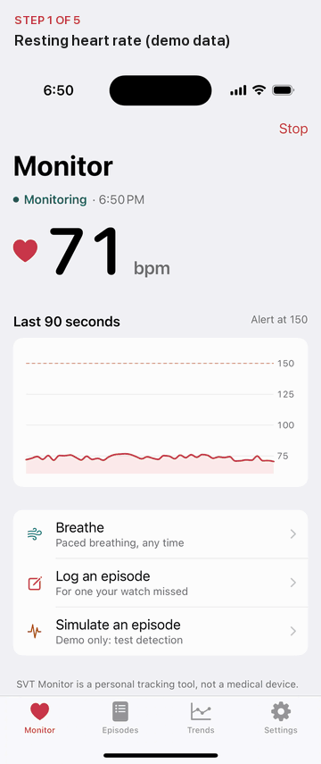
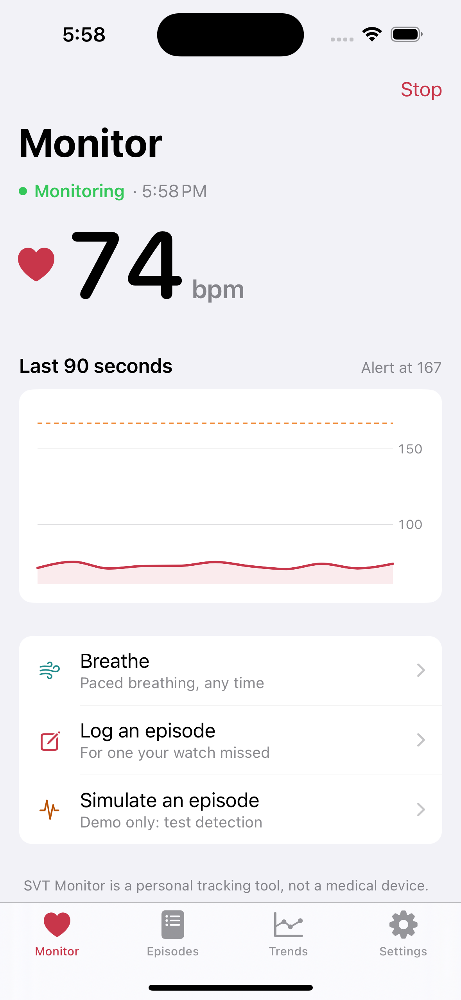
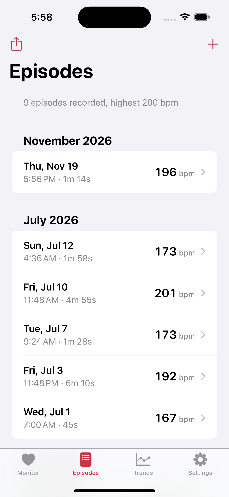
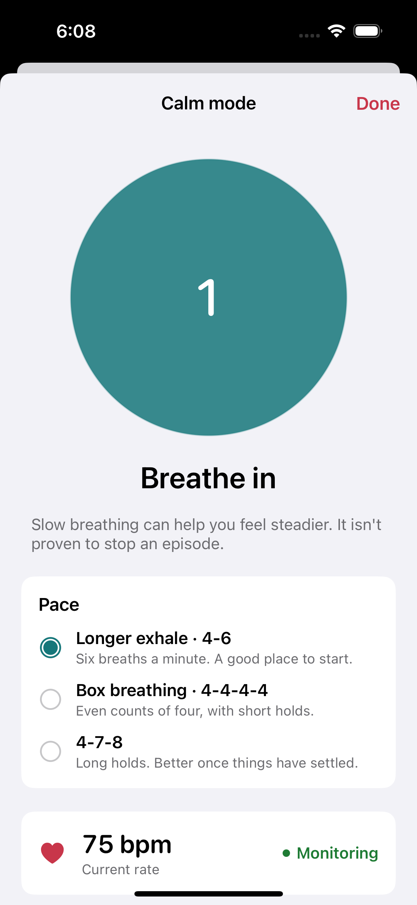

# SVT Monitor

An iOS app that watches Apple Watch heart rate for possible SVT episodes,
coaches you through slow breathing while one is happening, and keeps a log you
can take to your cardiologist.

**Swift · SwiftUI · HealthKit · SwiftData · Swift Charts · iOS 17**

<p align="center">
  
</p>
<p align="center"><sub>Recorded in the iOS simulator with demo data, shortened to about 40 seconds.</sub></p>

| Live Monitor | Episode Log | Calm Mode |
|:---:|:---:|:---:|
|  |  |  |

## Why

SVT (supraventricular tachycardia) makes the heart suddenly race, often at
150 to 220 bpm, and it can stop just as suddenly. By the time you see a doctor,
all you have to describe it is memory. This app records each episode as it
happens and helps in the moment, when it's hardest to think clearly.

## Features

- **Episode detection:** flags a possible episode when heart rate stays above
  your threshold or jumps suddenly, then records its start, end, peak and average.
- **Calm Mode:** opens on its own during an episode. It has a paced breathing
  guide, reminders of the vagal maneuvers your care team taught you, and when to
  call emergency services.
- **Episode log and trends:** symptoms, possible triggers and severity for each
  episode, with charts showing how often they happen and how high they peak.
- **Appointment summary:** export your history to share with your doctor.
- **Demo mode:** simulated heart rate that behaves like SVT (a sudden jump, a
  steady 160 to 200 bpm, then a sudden drop), so you can try everything without
  a watch, including in the simulator.

## Engineering highlights

- **Tested detection logic.** `EpisodeDetector` is a pure state machine with
  hysteresis, so a brief dip doesn't end an episode. It handles duplicate and
  out-of-order samples. There are **53 unit tests**, all passing.
- **Sourced health content.** Maneuver timings follow the REVERT trial
  (*The Lancet*, 2015), and emergency criteria follow the NHS. Tests fail if
  that wording drifts. All sources are listed in the app under
  Settings › Sources.
- **Accessible:**
  - Text meets WCAG 2.2 AA contrast in light and dark mode.
  - Supports Dynamic Type up to the largest accessibility sizes.
  - Adds VoiceOver labels and headers.
  - Respects Reduce Motion.
  - Tap targets are at least 44 pt.
- **MVVM with swappable data sources.** HealthKit and the simulator both
  implement one `HeartRateProvider` protocol.

Architecture, detection rules and the test suites are covered in
[docs/ARCHITECTURE.md](docs/ARCHITECTURE.md).

## Run it

1. Open `SVTMonitor.xcodeproj` in Xcode 15.4 or later.
2. Choose an iOS 17 simulator and press **Run**.

The simulator starts in demo mode with a few weeks of sample history. Tap
**Simulate an episode** to watch detection work from start to finish. On an
iPhone paired with an Apple Watch, the app reads live heart rate through
HealthKit instead.

```bash
xcodebuild test -project SVTMonitor.xcodeproj -scheme SVTMonitor \
  -destination 'platform=iOS Simulator,name=iPhone 15'
```

## Limitations and next steps

- **Apple Watch reads heart rate periodically, not continuously**
  ([Apple](https://support.apple.com/en-us/120277)), so a short episode can be
  missed. Manual logging covers that gap for now. Next step: a watchOS companion
  app that runs a workout session to get continuous readings.
- **Detection is a rule, not a diagnosis.** Exercise or anxiety can look the
  same, and only an ECG can tell which rhythm it is.

> SVT Monitor is a personal tracking tool, **not a medical device**, and has not
> been reviewed by a clinician.
